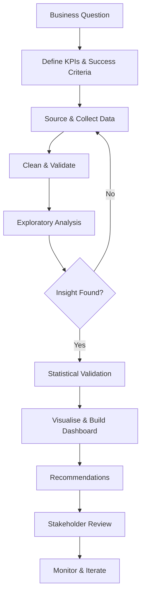
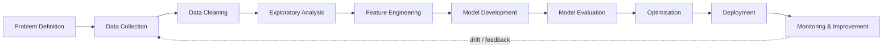
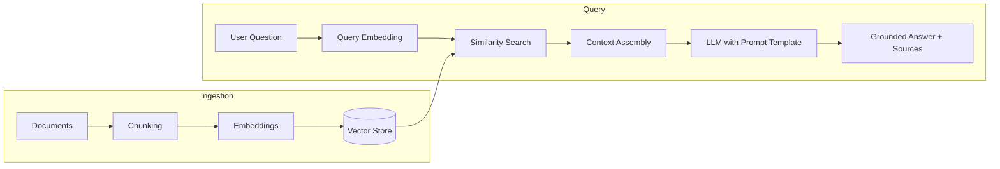

<!-- =====================================================================
     ADVANCED PROFESSIONAL GITHUB PROFILE README
     Search for "YOUR-" and replace every placeholder before publishing.
     Delete any section you cannot back up with real work.
     ===================================================================== -->

<div align="center">


<br/>

[](https://www.linkedin.com/in/YOUR-LINKEDIN)
[](mailto:YOUR-EMAIL@example.com)
[](https://YOUR-PORTFOLIO.com)
[](https://www.kaggle.com/YOUR-KAGGLE)
[](https://medium.com/@YOUR-MEDIUM)
[](https://YOUR-RESUME-LINK)


</div>

---

## 📑 Table of Contents

| # | Section | # | Section |
|---|---|---|---|
| 1 | [Professional Summary](#-professional-summary) | 9 | [Machine Learning Lifecycle](#-machine-learning-lifecycle) |
| 2 | [Profile at a Glance](#-profile-at-a-glance) | 10 | [Generative AI & LLM Engineering](#-generative-ai--llm-engineering) |
| 3 | [What I Do](#-what-i-do) | 11 | [Code Samples](#-code-samples) |
| 4 | [Technical Stack](#-technical-stack) | 12 | [Experience & Timeline](#-experience--timeline) |
| 5 | [Skill Matrix](#-skill-matrix) | 13 | [Learning Roadmap](#-learning-roadmap) |
| 6 | [Analytics Workflow](#-analytics-workflow) | 14 | [GitHub Analytics](#-github-analytics) |
| 7 | [Featured Projects](#-featured-projects) | 15 | [Certifications & Achievements](#-certifications--achievements) |
| 8 | [Project Case Study Template](#-project-case-study) | 16 | [Writing, FAQ & Contact](#-contact) |

---

## 🧭 Professional Summary

I am a **Data Analyst and Data Science practitioner moving into AI Engineering**. I work across the full data lifecycle: sourcing and cleaning data, exploratory and statistical analysis, business intelligence reporting, machine learning, and packaging results into applications that other people can actually use.

My approach is simple: **start from the business question, not the model.** Every dataset I touch is treated as a decision-support problem. The goal is not a chart or an accuracy number, it is a recommendation someone can act on.

> **Raw Data → Clean Data → Insights → Intelligence → Business Impact**

**Strengths I bring to a team**

- 🔎 **Analytical rigour:** hypothesis-driven analysis, validation of data quality before conclusions
- 📊 **Storytelling with data:** dashboards and reports written for decision-makers, not just analysts
- 🧪 **Practical ML:** baseline-first modelling, honest evaluation, clear documentation
- 🤖 **GenAI fluency:** LLM APIs, prompt design, embeddings and retrieval-augmented systems
- 🛠️ **End-to-end delivery:** from notebook to Streamlit or Django application

---

## 🪪 Profile at a Glance

| | |
|---|---|
| 🎯 **Target roles** | Data Analyst · Business Intelligence Analyst · Data Scientist · AI / ML Engineer |
| 🔭 **Currently building** | Add your current project here |
| 🌱 **Currently learning** | LLM application design, RAG evaluation, MLOps fundamentals |
| 🧰 **Primary tools** | Python, SQL, Power BI, Excel, Scikit-Learn, Streamlit |
| 📍 **Location** | YOUR CITY, COUNTRY (open to remote / relocation) |
| 🗣️ **Languages** | English, add others |
| 📫 **Best way to reach me** | Email or LinkedIn |
| ⚡ **Fun fact** | Add something memorable |

---

## 💼 What I Do

<table>
<tr>
<td width="50%" valign="top">

### 📊 Data Analytics & BI
- Explore datasets to find patterns, trends and anomalies
- Write SQL for extraction, joins, aggregation and cohort analysis
- Build interactive **Power BI** dashboards with DAX measures
- Automate reporting with Python and Excel
- Define and track KPIs aligned to business goals

</td>
<td width="50%" valign="top">

### 🤖 Machine Learning & AI
- Build classification, regression and clustering models
- Engineer features and evaluate with appropriate metrics
- Experiment with deep learning (TensorFlow, Keras, PyTorch)
- Build LLM and RAG applications with LangChain and vector search
- Integrate models into apps and APIs

</td>
</tr>
<tr>
<td width="50%" valign="top">

### 🧹 Data Preparation & Quality
- Cleaning, transformation and preprocessing pipelines
- Missing-value strategy, outlier handling, validation rules
- Data quality checks before any modelling begins
- Reproducible notebooks and documented assumptions

</td>
<td width="50%" valign="top">

### 🌐 Application Development
- Interactive data apps with **Streamlit**
- Web applications with **Django** and **Flask**
- Front-end basics with HTML, CSS, JavaScript and React
- Version control and collaboration with Git and GitHub

</td>
</tr>
</table>

---

## 🛠️ Technical Stack

### Programming & Querying

&nbsp;

### Data Analysis & Science


### Visualisation & Business Intelligence


### Machine Learning


### Generative AI & LLMs


**Focus areas:** Prompt Engineering · RAG · Embeddings · Vector Search · AI APIs · Intelligent Automation · Model Integration

### Databases


### Web, Cloud & Tooling

&nbsp;


---

## 📐 Skill Matrix

> Be honest here. Recruiters probe whatever you rate highest. Adjust the levels to match your real confidence.

| Domain | Skills | Level |
|---|---|---|
| **Programming** | Python, SQL | ⭐⭐⭐⭐☆ |
| **Data Wrangling** | Pandas, NumPy, Power Query, Excel | ⭐⭐⭐⭐☆ |
| **Visualisation / BI** | Power BI, Matplotlib, Seaborn, Plotly, Tableau | ⭐⭐⭐⭐☆ |
| **Statistics** | Descriptive stats, probability, hypothesis testing | ⭐⭐⭐☆☆ |
| **Machine Learning** | Scikit-Learn, XGBoost, model evaluation | ⭐⭐⭐☆☆ |
| **Deep Learning** | TensorFlow, Keras, PyTorch | ⭐⭐☆☆☆ |
| **Generative AI** | LLM APIs, prompt design, RAG, embeddings | ⭐⭐⭐☆☆ |
| **App Development** | Streamlit, Django, Flask | ⭐⭐⭐☆☆ |
| **Cloud & DevOps** | GCP, Azure, Git, Codespaces | ⭐⭐☆☆☆ |

### Analytics capability breakdown

<details>
<summary><b>🧹 Data Preparation</b></summary>

- Data cleaning and standardisation
- Data preprocessing and transformation
- Missing-value handling (deletion, imputation, indicator flags)
- Data validation and schema checks
- Feature preparation and encoding
- Data quality audits (duplicates, ranges, consistency, referential integrity)
</details>

<details>
<summary><b>🔍 Exploratory Data Analysis</b></summary>

- Univariate analysis: distributions, skewness, spread
- Bivariate analysis: relationships between a feature and the target
- Multivariate analysis: interactions, pivoting, segmentation
- Trend and seasonality analysis
- Pattern detection and anomaly spotting
- Outlier detection (IQR, z-score, isolation methods)
- Correlation analysis and multicollinearity checks
</details>

<details>
<summary><b>📐 Statistical Analysis</b></summary>

- Descriptive statistics and central tendency
- Measures of dispersion and shape
- Probability fundamentals and common distributions
- Correlation and association
- Hypothesis testing fundamentals (t-test, chi-square, ANOVA basics)
- Confidence intervals and clear statistical interpretation
</details>

<details>
<summary><b>📊 Business Intelligence</b></summary>

- Data modelling: star schema, relationships, granularity
- DAX measures, time intelligence, calculated columns
- Dashboard design: layout, drill-through, filtering, tooltips
- KPI definition and executive-level reporting
- Report automation and refresh scheduling
</details>

---

## 🔄 Analytics Workflow

How I approach a typical analytics engagement:



| Stage | What I deliver |
|---|---|
| **Frame** | A written problem statement, KPIs and assumptions |
| **Prepare** | A cleaned dataset with a documented data-quality log |
| **Analyse** | EDA notebook with findings ranked by business relevance |
| **Communicate** | Dashboard or report, plus a one-page summary of recommendations |
| **Sustain** | Refresh logic, documentation and a handover note |

---

## 🚀 Featured Projects

> Replace the placeholder rows with real projects. Lead with the business problem and a measurable result, not the list of tools.

### 📊 Data Analytics & BI

| Project | Problem | Approach | Result | Stack |
|---|---|---|---|---|
| **[Sales Performance Dashboard](https://github.com/YOUR-USERNAME/REPO)** | Describe the business problem | Data model, KPIs, DAX measures | Measurable outcome | Power BI · SQL · Excel |
| **[Customer Segmentation Analysis](https://github.com/YOUR-USERNAME/REPO)** | Describe the problem | RFM or clustering on transactions | Measurable outcome | Python · Pandas · Plotly |
| **[Retail / Operations EDA](https://github.com/YOUR-USERNAME/REPO)** | Describe the problem | Trend, seasonality, outlier analysis | Measurable outcome | Python · Seaborn · SQL |

### 🤖 Machine Learning

| Project | Problem | Approach | Result | Stack |
|---|---|---|---|---|
| **[Churn / Risk Prediction](https://github.com/YOUR-USERNAME/REPO)** | Describe the problem | Feature engineering, class imbalance handling | e.g. F1, ROC-AUC on a held-out set | Scikit-Learn · XGBoost |
| **[Demand / Price Forecasting](https://github.com/YOUR-USERNAME/REPO)** | Describe the problem | Time-series features, backtesting | e.g. MAPE vs. baseline | Python · Statsmodels |

### 🧠 Generative AI & Applications

| Project | Problem | Approach | Result | Stack |
|---|---|---|---|---|
| **[Document Q&A with RAG](https://github.com/YOUR-USERNAME/REPO)** | Describe the problem | Chunking, embeddings, retrieval, grounded answers | Qualitative or evaluated outcome | LangChain · Vector DB · Streamlit |
| **[Full-Stack Data App](https://github.com/YOUR-USERNAME/REPO)** | Describe the problem | Auth, database, dashboards | Live demo link | Django · PostgreSQL |

### 📌 Pinned Repositories

<p align="center">
  <a href="https://github.com/YOUR-GITHUB-USERNAME/REPO-1"></a>
  <a href="https://github.com/YOUR-GITHUB-USERNAME/REPO-2"></a>
</p>
<p align="center">
  <a href="https://github.com/YOUR-GITHUB-USERNAME/REPO-3"></a>
  <a href="https://github.com/YOUR-GITHUB-USERNAME/REPO-4"></a>
</p>

---

## 🧩 Project Case Study

Every major project in my portfolio follows the same structure, so you can scan it quickly:

| Section | Contents |
|---|---|
| **1. Business Context** | Who the stakeholder is and what decision the analysis supports |
| **2. Data** | Source, size, time range, known limitations |
| **3. Method** | Cleaning steps, analysis or modelling approach, why it was chosen |
| **4. Findings** | Top insights ranked by impact, with supporting charts |
| **5. Evaluation** | Metrics, baselines, validation approach, error analysis |
| **6. Recommendations** | Concrete actions and expected impact |
| **7. Reproducibility** | `requirements.txt`, data dictionary, how to run the notebook or app |

<details>
<summary><b>📝 Example case study (template to copy into a project README)</b></summary>

```markdown
# Project Title

## Business Problem
One paragraph: who needs this, and what decision does it inform?

## Dataset
- Source:
- Rows / columns:
- Period covered:
- Known issues:

## Approach
1. Data cleaning and validation
2. Exploratory analysis
3. Modelling / dashboard design
4. Evaluation and iteration

## Key Findings
- Finding 1 (with metric)
- Finding 2 (with metric)
- Finding 3 (with metric)

## Recommendations
- Action 1
- Action 2

## How to Run
pip install -r requirements.txt
streamlit run app.py
```
</details>

---

## 🧪 Machine Learning Lifecycle



**Principles I follow**

- **Baseline first.** A simple, interpretable model sets the bar before anything complex is tried.
- **Prevent leakage.** Train / validation / test splits and pipelines are built so no future information enters training.
- **Choose metrics for the problem.** Accuracy is rarely enough: precision, recall, F1, ROC-AUC, MAE or MAPE are selected based on cost of errors.
- **Validate properly.** Cross-validation, time-based splits for temporal data, and error analysis by segment.
- **Explain the model.** Feature importance and SHAP-style explanations for stakeholder trust.
- **Document everything.** Assumptions, limitations and reproducible environments.

| Task | Techniques I work with |
|---|---|
| **Classification** | Logistic Regression, Random Forest, Gradient Boosting, XGBoost |
| **Regression** | Linear / Ridge / Lasso, tree ensembles, XGBoost |
| **Clustering** | K-Means, hierarchical, DBSCAN |
| **Dimensionality reduction** | PCA |
| **Evaluation** | Cross-validation, confusion matrix, ROC / PR curves, hyperparameter search |
| **Deep learning** | Feed-forward networks in Keras / TensorFlow, PyTorch fundamentals |

---

## ✨ Generative AI & LLM Engineering

A typical retrieval-augmented generation (RAG) system I build or study:



**Areas of practice**

| Area | Details |
|---|---|
| **Prompt engineering** | Structured prompts, few-shot examples, output formatting, guardrails |
| **RAG** | Chunking strategies, embeddings, retrieval, source citation |
| **Vector search** | Similarity search, metadata filtering |
| **AI APIs** | OpenAI, Gemini, Hugging Face integration |
| **Evaluation** | Checking answer faithfulness, retrieval relevance, failure cases |
| **Applications** | Streamlit front-ends, automation workflows, model integration |

---

## 💻 Code Samples

<details>
<summary><b>🐍 Python: reusable data-quality report</b></summary>

```python
import pandas as pd

def data_quality_report(df: pd.DataFrame) -> pd.DataFrame:
    """Return a per-column summary of type, missingness, uniqueness and range."""
    report = pd.DataFrame({
        "dtype": df.dtypes.astype(str),
        "missing_count": df.isna().sum(),
        "missing_pct": (df.isna().mean() * 100).round(2),
        "unique_values": df.nunique(),
    })
    numeric = df.select_dtypes("number")
    report["min"] = numeric.min()
    report["max"] = numeric.max()
    report["duplicates_in_frame"] = df.duplicated().sum()
    return report.sort_values("missing_pct", ascending=False)
```
</details>

<details>
<summary><b>🗄️ SQL: monthly revenue with growth and running total</b></summary>

```sql
WITH monthly AS (
    SELECT
        DATE_TRUNC('month', order_date) AS month,
        SUM(amount)                     AS revenue
    FROM orders
    WHERE status = 'completed'
    GROUP BY 1
)
SELECT
    month,
    revenue,
    revenue - LAG(revenue) OVER (ORDER BY month)                       AS mom_change,
    ROUND(100.0 * (revenue - LAG(revenue) OVER (ORDER BY month))
          / NULLIF(LAG(revenue) OVER (ORDER BY month), 0), 2)          AS mom_growth_pct,
    SUM(revenue) OVER (ORDER BY month)                                 AS running_total
FROM monthly
ORDER BY month;
```
</details>

<details>
<summary><b>📊 DAX: year-over-year sales measure</b></summary>

```dax
Total Sales = SUM ( Sales[Amount] )

Sales LY =
CALCULATE ( [Total Sales], SAMEPERIODLASTYEAR ( 'Date'[Date] ) )

YoY Growth % =
DIVIDE ( [Total Sales] - [Sales LY], [Sales LY] )
```
</details>

<details>
<summary><b>🤖 Python: leak-free ML pipeline with cross-validation</b></summary>

```python
from sklearn.compose import ColumnTransformer
from sklearn.ensemble import RandomForestClassifier
from sklearn.impute import SimpleImputer
from sklearn.model_selection import cross_val_score, StratifiedKFold
from sklearn.pipeline import Pipeline
from sklearn.preprocessing import OneHotEncoder, StandardScaler

numeric_cols = ["age", "income"]          # replace with your columns
categorical_cols = ["segment", "region"]  # replace with your columns

preprocess = ColumnTransformer([
    ("num", Pipeline([("impute", SimpleImputer(strategy="median")),
                      ("scale", StandardScaler())]), numeric_cols),
    ("cat", Pipeline([("impute", SimpleImputer(strategy="most_frequent")),
                      ("encode", OneHotEncoder(handle_unknown="ignore"))]), categorical_cols),
])

model = Pipeline([
    ("preprocess", preprocess),
    ("clf", RandomForestClassifier(n_estimators=300, random_state=42, class_weight="balanced")),
])

cv = StratifiedKFold(n_splits=5, shuffle=True, random_state=42)
scores = cross_val_score(model, X, y, cv=cv, scoring="f1")
print(f"F1: {scores.mean():.3f} ± {scores.std():.3f}")
```
</details>

<details>
<summary><b>🧠 Python: minimal RAG retrieval sketch</b></summary>

```python
import numpy as np

def cosine_top_k(query_vec, doc_vecs, k=3):
    """Return indices of the k most similar document vectors."""
    q = query_vec / np.linalg.norm(query_vec)
    d = doc_vecs / np.linalg.norm(doc_vecs, axis=1, keepdims=True)
    return np.argsort(-(d @ q))[:k]

def build_prompt(question, retrieved_chunks):
    context = "\n\n".join(f"[{i+1}] {c}" for i, c in enumerate(retrieved_chunks))
    return (
        "Answer using only the context below. "
        "If the answer is not in the context, say so.\n\n"
        f"Context:\n{context}\n\nQuestion: {question}\nAnswer (cite sources like [1]):"
    )
```
</details>

---

## 🕰️ Experience & Timeline

> Add real entries. Use the format: **what you did → how → result.**

| Period | Role / Activity | Highlights |
|---|---|---|
| 20XX – Present | **Your current role / self-directed projects** | Key responsibilities and a quantified result |
| 20XX – 20XX | **Internship / Freelance / Academic project** | What you built and the outcome |
| 20XX – 20XX | **Education: Degree, Institution** | Relevant coursework, thesis, honours |

---

## 🗺️ Learning Roadmap

| Track | Status | Next milestone |
|---|---|---|
| Advanced SQL (window functions, optimisation) | 🟢 Active | Query tuning on large tables |
| Statistics & experimentation (A/B testing) | 🟢 Active | Design and analyse a full experiment |
| Machine learning (ensembles, evaluation) | 🟢 Active | Publish an end-to-end project with documentation |
| LLM applications and RAG evaluation | 🟡 Exploring | Build and evaluate a domain-specific RAG app |
| MLOps (experiment tracking, deployment) | 🟡 Exploring | Deploy a model behind an API |
| Cloud data platforms | 🔵 Planned | Hands-on project on GCP or Azure |

---

## 📈 GitHub Analytics

<div align="center">


</div>

---

## 🏆 Certifications & Achievements

### Certifications
| Certification | Issuer | Year | Credential |
|---|---|---|---|
| Add certification | Issuer | 20XX | [Verify](https://YOUR-CREDENTIAL-LINK) |
| Add certification | Issuer | 20XX | [Verify](https://YOUR-CREDENTIAL-LINK) |

### Achievements
- 🥇 Competition, hackathon or case-study result
- 📜 Publication, talk or open-source contribution
- 🎓 Scholarship, award or recognition

---

## ✍️ Writing & Learning in Public

I document what I learn to deepen my understanding and help others.

| Topic | Link |
|---|---|
| Add article title (e.g. "A practical guide to handling missing data") | [Read](https://YOUR-ARTICLE-LINK) |
| Add article title (e.g. "RAG from scratch: lessons learned") | [Read](https://YOUR-ARTICLE-LINK) |

---

## ❓ FAQ

<details>
<summary><b>What kind of roles are you looking for?</b></summary>

Data Analyst, BI Analyst, Data Scientist and entry-level AI / ML Engineer roles, ideally where analysis directly informs decisions.
</details>

<details>
<summary><b>Are you open to freelance or collaboration?</b></summary>

Yes. Dashboards, exploratory analysis, ML prototypes and Streamlit apps are the kinds of projects I take on. Reach out by email with a short description.
</details>

<details>
<summary><b>How do you approach a new dataset?</b></summary>

Define the business question and KPIs, audit data quality, explore before modelling, validate findings statistically, then communicate with clear visuals and recommendations.
</details>

<details>
<summary><b>What are you working on improving?</b></summary>

Production-grade ML (MLOps), rigorous experimentation, and evaluating LLM applications beyond demos.
</details>

---

## 🤝 Contact

I am open to **data analytics, data science and AI engineering opportunities**, internships, freelance work and collaborations.

| Channel | Details |
|---|---|
| 📫 **Email** | YOUR-EMAIL@example.com |
| 💼 **LinkedIn** | [linkedin.com/in/YOUR-LINKEDIN](https://www.linkedin.com/in/YOUR-LINKEDIN) |
| 🌐 **Portfolio** | [YOUR-PORTFOLIO.com](https://YOUR-PORTFOLIO.com) |
| 📊 **Kaggle** | [kaggle.com/YOUR-KAGGLE](https://www.kaggle.com/YOUR-KAGGLE) |
| 📄 **Resume** | [Download PDF](https://YOUR-RESUME-LINK) |

<div align="center">

<br/>

**Thanks for visiting. If something here is useful, a ⭐ on a repository is always appreciated.**


</div>
