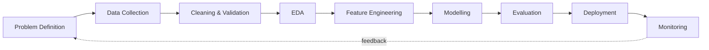

<!-- ============ HEADER ============ -->
<h1 align="center">Hi, I'm YOUR NAME 👋</h1>

  

  
  
  
  

  
  

---

## 🧭 About Me

I'm a **Data Analyst and Data Science enthusiast** moving toward **AI Engineering**. I work across the full data lifecycle: collecting and cleaning data, analysing it, building dashboards and ML models, and shipping the result as a usable application.

> **Raw Data → Clean Data → Insights → Intelligence → Business Impact**

| | |
|---|---|
| 🔭 **Currently building** | Add your current project here |
| 🌱 **Currently learning** | LLM applications, RAG pipelines, MLOps basics |
| 🎯 **Looking for** | Data Analyst / Data Scientist / AI roles and collaborations |
| 💬 **Ask me about** | Python, SQL, Power BI, EDA, ML, GenAI |
| ⚡ **Fun fact** | Add one that makes you memorable |

---

## 🛠️ Tech Stack

**Languages & Querying**

 &nbsp; 

**Data Analysis & Visualisation**

**Machine Learning & AI**

**Databases, Apps & Cloud**

&nbsp;

---

## 🔄 How I Work

---

## 🚀 Featured Projects

> Replace each row with a real project. Lead with the business problem and a measurable result.

| Project | Problem & Approach | Impact | Stack |
|---|---|---|---|
| 📊 **[Project Name](https://github.com/YOUR-USERNAME/REPO)** | One line: the problem, data used, method | e.g. "Cut reporting time by 60%" | Python · SQL · Power BI |
| 🤖 **[Project Name](https://github.com/YOUR-USERNAME/REPO)** | One line: model, dataset, evaluation metric | e.g. "F1 0.91 on held-out test set" | Scikit-Learn · XGBoost |
| 🧠 **[Project Name](https://github.com/YOUR-USERNAME/REPO)** | One line: RAG / LLM app, what it answers | e.g. "Answers from 500+ docs with citations" | LangChain · Streamlit · Vector DB |
| 🌐 **[Project Name](https://github.com/YOUR-USERNAME/REPO)** | One line: full-stack data app | e.g. "Live demo with 100+ users" | Django · PostgreSQL |

---

## 📈 Core Competencies

<b>🧹 Data Preparation</b>

Data cleaning · preprocessing · transformation · missing-value handling · validation · quality checks · feature preparation

<b>🔍 Exploratory Data Analysis</b>

Univariate, bivariate and multivariate analysis · trend and pattern detection · outlier detection · correlation and distribution analysis

<b>📐 Statistics</b>

Descriptive statistics · probability · central tendency and dispersion · correlation · hypothesis testing · interpretation of results

<b>🤖 Machine Learning</b>

Supervised and unsupervised learning · model evaluation and tuning · feature engineering · deployment with Streamlit / Django

<b>✨ Generative AI</b>

Prompt engineering · LLM APIs · embeddings · vector search · Retrieval-Augmented Generation (RAG) · AI application development · intelligent automation

<b>📊 Business Intelligence</b>

Power BI dashboards · Power Query · DAX · Excel reporting · SQL aggregation and business analysis · KPI storytelling

---

## 📊 GitHub Stats

  
  

  

---

## 🏆 Certifications & Achievements

- 🎓 Add certification (issuer, year)
- 🥇 Add competition / hackathon result
- 📝 Add article, blog or talk

---

## 🤝 Let's Connect

I'm open to **data analytics, data science and AI engineering opportunities**, internships and collaborations.

📫 **Email:** YOUR-EMAIL@example.com  
💼 **LinkedIn:** [linkedin.com/in/YOUR-LINKEDIN](https://www.linkedin.com/in/YOUR-LINKEDIN)  
🌐 **Portfolio:** [YOUR-PORTFOLIO.com](https://YOUR-PORTFOLIO.com)

  

<i>⭐ If something here is useful, a star on a repo is always appreciated.</i>

